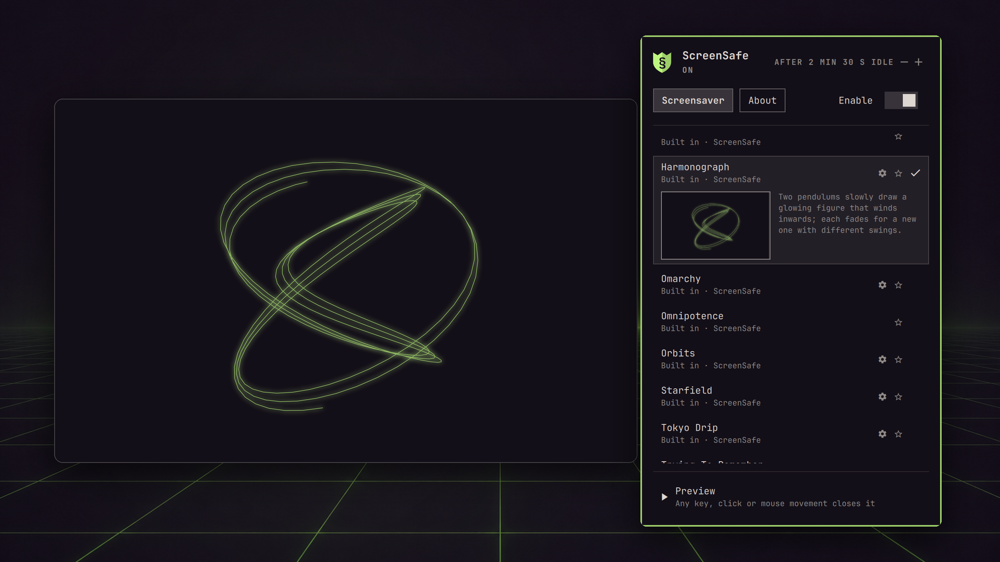

# ScreenSafe

Screensavers for [Omarchy](https://omarchy.org) made of data, not code: ASCII art, line art, text and images, drawn sharp on every screen, in your theme's colors.



A screensaver here is a **pack**: a folder holding a `screensafe.toml` and its art. A pack can describe text and ASCII art, lines, curves and turning wireframes, glowing or not, and images, in ScreenSafe's font or its own. It can animate them with small formulas such as `sin(t * 2)`, written in a language that can't loop, read files or reach the network. ScreenSafe draws the pack itself. Nothing in a pack ever runs as a program, so a pack from someone else can't do any more than draw pictures.

ScreenSafe draws on Wayland's overlay layer rather than in a terminal: on every screen, over the desktop, its windows and the bar. The art is drawn at your screen's full resolution, at any scale, and a frame that hasn't changed isn't drawn again.

## Install

```sh
omarchy plugin add https://github.com/jeremydixon22/omarchy-screensafe
omarchy plugin enable io.github.jeremydixon22.screensafe
```

Enabling puts ScreenSafe's shield in the bar, in your theme's accent. Nothing changes until you turn ScreenSafe on: Omarchy's own screensaver stays in use until then.

ScreenSafe needs Omarchy 4, on an x86-64 or 64-bit ARM computer. It has been tested on Omarchy 4.0.4 with Hyprland 0.56 and Quickshell 0.3.1 on x86-64; the ARM build has been tested under emulation, drawing identical frames.

## Use

Click the icon in the bar:

- **Enable**, beside the tabs: show ScreenSafe instead of Omarchy's screensaver when you're idle. Right-clicking the icon does the same.
- **After … idle**, at the top right: how long you're idle before it shows. It follows Omarchy's screensaver time until you choose your own with **−** and **+** (or the arrow keys), from 1 minute to an hour; step back below 1 minute to follow Omarchy's again. Omarchy's own setting isn't changed. Point at it to see whose time it is and when Omarchy locks. If anything stops ScreenSafe showing, such as Omarchy locking first, a note says so at the bottom of the panel.
- **Pack**: which screensaver to show. **Automatic** shows the current theme's pack if it has one, and the Omarchy pack otherwise. Rest on a pack, with the pointer or the arrow keys, and its row opens to show a thumbnail of it in your theme's colors, beside what it shows; the chosen pack is ticked. Click a pack's ☆, or press `f`, to make it a favorite: favorites are listed first, by name. A pack with settings has a ⚙: click it, or press → or `s` on its row, to change them. The page shows the pack running live as you change them; turn **Live preview** off for a still thumbnail and the usual Preview.
- **Preview**, at the bottom of the panel: show the chosen pack now. Any key, click, touch or mouse movement closes it.
- **About**, the panel's second tab: links to this page, to the catalog of packs others have made (**Find a screensaver**), to how to make a screensaver (with the agent skill), and to how to share one.

From a terminal or a key binding:

```sh
omarchy-shell screensafe preview
omarchy-shell screensafe enable        # or: disable
omarchy-shell screensafe pack auto     # or the path of a pack the panel lists
omarchy-shell screensafe delay 300     # seconds idle before it shows; omarchy to follow Omarchy's
omarchy-shell screensafe favorite PATH # star or unstar a pack the panel lists
omarchy-shell screensafe status
```

### With Omarchy's own screensaver

While **Enable** is on, ScreenSafe switches Omarchy's screensaver off and opens its own when Omarchy's would have opened. Turning it off, disabling the plugin or removing it switches Omarchy's back on. If you had already switched Omarchy's screensaver off yourself, ScreenSafe leaves it as you set it.

Omarchy stays in charge of everything else:

- **Timing:** unless you choose ScreenSafe's own time, it opens one second after Omarchy's screensaver would have (`idle.screensaver` in `~/.config/omarchy/shell.json`).
- **Locking:** Omarchy still locks on its own schedule (`idle.lock`), and locking closes the screensaver. If ScreenSafe's time is longer than that, Omarchy locks first, and the panel says so.
- **Stay awake** pauses ScreenSafe just as it pauses Omarchy's screensaver.
- **Video and games:** whatever keeps Omarchy's screensaver away keeps ScreenSafe away too. It watches for idle the same way, honoring apps that ask Wayland to keep the screen awake.

If you switch Omarchy's screensaver back on yourself (for example with `omarchy toggle screensaver`), ScreenSafe steps aside and turns itself off the next time it would have opened.

The **Screensaver** entry in Omarchy's menu always opens Omarchy's own screensaver. To open ScreenSafe's, use **Preview** or `omarchy-shell screensafe preview`.

If the shell stops while ScreenSafe holds Omarchy's screensaver off, Omarchy's stays off until ScreenSafe next loads, or until you remove `~/.local/state/omarchy/toggles/screensaver-off`.

## Packs

ScreenSafe comes with fourteen:

- **Omarchy**: your screensaver art from *Style > Screensaver*, revealed a different way each time, in the theme's colors.
- **Orbits**: the Omarchy box, its mark on two sides, turning in its orbits; then a slowly changing Lissajous figure.
- **Theme backgrounds**: your theme's own backgrounds, one after another, drifting slowly across the screen.
- **Starfield**: flying through stars that streak past as they come close.
- **Echoes**: two shapes bouncing around the screen, trailing echoes of where they've been.
- **Cascade**: columns of ever-changing digits falling down the screen.
- **Harmonograph**: two pendulums drawing a glowing figure that winds inwards, a new one each time round.
- **Constellations**: drifting stars, joined by faint lines whenever two pass close.
- **Trying To Remember**: aimless thoughts wandering through a fog of half-remembered ones, each reaching for an idea that glows just out of reach.
- **Distro Wars**: a parody of a popular God-game. The Omarch King defends his realm from rivals. One by one, settlements fly Omarchy green. Eventually, disaster strikes in the form of segfault and Dependency Hell.
- **Omnipotence**: figures drawn over the very lines of code that draw them, each line lighting up as it works, until the Hand of Omnipotence turns the page.
- **Fibonacci**: the sequence in pictures: squares and their spiral, a sunflower, generations of rabbits, Pascal's triangle, the golden ratio, and the Fibonacci word fractal.
- **Tokyo Drip**: a rainy Tokyo side street at night: neon signs, lanterns and an LED screen, as rain drips onto the wet street, in your theme's colors.
- **Badge**: ScreenSafe's shield or the Omarchy mark, or your own badge, bouncing, shattering, waving and in orbit, smoothly or as pixel art in your theme's colors. To show yours, put an image at `~/.config/omarchy/screensafe/badge.png` (or `.webp` or `.jpg`).

**From a theme:** a theme can ship a pack in a `screensafe` folder next to its `colors.toml`. Omarchy keeps that folder when it installs the theme, since it's only data, and ScreenSafe shows it while that theme is in use.

**Your own:** put a pack folder in `~/.config/omarchy/screensafe/packs/`, and it appears in the panel the next time you open it.

To make a pack, start with [Making a screensaver](docs/MAKING.md); the format is in [Making packs](docs/PACKS.md) and [Expressions](docs/EXPRESSIONS.md). If you work with a coding agent, [`skills/screensafe-packs`](skills/screensafe-packs/SKILL.md) is an agent skill (a `SKILL.md`) that walks it through making, checking and sharing packs: link that folder into your agent's skills folder, such as `~/.claude/skills/`. The renderer checks a pack and reports anything wrong, line by line:

```sh
~/.config/omarchy/plugins/io.github.jeremydixon22.screensafe/bin/screensafe-$(uname -m) check path/to/pack
```

## Safety

- **Packs are data.** The format has no way to run a program, open a file outside its own folder, reach the network or loop without end. Everything a pack asks for is checked and compiled before it's shown, and every per-frame cost is bounded.
- **The renderer confines itself.** Before reading a pack it can only read the packs, theme and art it was given; after loading it, it gives up all file access. It can never reach the network or start programs. This uses Linux's Landlock, wherever the kernel supports it.
- **Flashing is limited.** The renderer measures every frame and won't show more than three large-area flashes a second, the WCAG 2.2 limit for photosensitivity, whatever a pack asks for.

See [SECURITY.md](SECURITY.md) for the details and how to report a problem.

## Remove

```sh
omarchy plugin remove io.github.jeremydixon22.screensafe
```

Removing the plugin switches Omarchy's screensaver back on if ScreenSafe had switched it off. ScreenSafe keeps a small record in `~/.local/state/screensafe/` while it holds Omarchy's screensaver off; you can delete that folder afterwards. Your own packs in `~/.config/omarchy/screensafe/` are left in place.

## What's inside

- `Service.qml`, `Panel.qml` and `ShieldMark.qml`: the plugin. They start only ScreenSafe's own renderer and Omarchy's `omarchy-shell` (to ask whether the session is locked).
- `bin/screensafe-x86_64` and `bin/screensafe-aarch64`: the renderer, static Linux executables built reproducibly from [`renderer/`](renderer). The plugin runs the one for your machine. See [how to rebuild them and check that they match](docs/BINARY-PROVENANCE.md).
- `packs/`: the built-in packs.
- `skills/screensafe-packs/`: instructions for coding agents that make packs. The plugin doesn't install or read them.

The renderer embeds [JetBrains Mono](https://github.com/JetBrains/JetBrainsMono) (SIL Open Font License 1.1) and uses the Rust libraries listed in [THIRD_PARTY_NOTICES.md](THIRD_PARTY_NOTICES.md). It needs nothing else at run time.

The expression language borrows ideas and a few function names from MilkDrop's preset equations, but no code; [Expressions](docs/EXPRESSIONS.md#compared-with-milkdrop) describes how they differ.

## License

MIT; see [LICENSE](LICENSE).
