<p align="center">
  
</p>

<h1 align="center">ScreenSafe</h1>

<p align="center">
  <b>Screensavers for <a href="https://omarchy.org">Omarchy</a>, made of data, not code.</b><br>
  ASCII art, line art, glowing curves, neon streets and pixel kingdoms: drawn sharp on every screen, in your theme's colors.
</p>

<p align="center">
  <a href="https://github.com/jeremydixon22/omarchy-screensafe/actions/workflows/ci.yml"></a>
  
  
  
</p>


A screensaver in ScreenSafe is a **pack**: a folder with a `screensafe.toml` and its art. A pack describes what to draw and how it moves, with small formulas like `sin(t * 2)` in a language that can't loop, read files or reach the network. ScreenSafe draws the pack itself, and nothing in a pack ever runs as a program, **so a pack from someone else can only describe pictures.**

- **Sixteen packs built in**, from a harmonograph's glowing figures to a rainy Tokyo side street, your own photos, and local videos.
- **Your theme, everywhere.** Packs draw in the current theme's palette, and a theme can bring a pack of its own.
- **Sharp on every screen.** Native Wayland drawing; video uses a bounded canvas scaled by the compositor.
- **Settings without code.** Packs can offer a speed, a density or a picture; change them in the panel and watch the pack update live.
- **Made to be safe.** A sandboxed renderer, a checked format, and a flash limit no pack can get past.

**0.6.0 testing candidate:** combines the compiler and sprite optimizations, video styles, theme colors, trusted overlay and opt-in prepared loops with compressed SSVv2 videos. H.264 hardware decoding is an explicit control under Settings → Performance; the live preview and full-screen player use the same policy and final flash guard. All application helpers are included for x86-64 and ARM64; installation builds and downloads nothing else. See [the Videos guide](docs/VIDEO-PROTOTYPE.md). Marketplace approval of 0.4.8 does not cover this candidate; verify the exact commit and binary attestations as described below.

The [SSVv2 boundary notes](docs/SSV2-PROTOTYPE.md) describe codec isolation, hardware authority and owned frame delivery. Existing JPEG clips remain supported, and final-composition flash guarding stays active in both video modes.

## The packs

| | | |
|:---:|:---:|:---:|
| 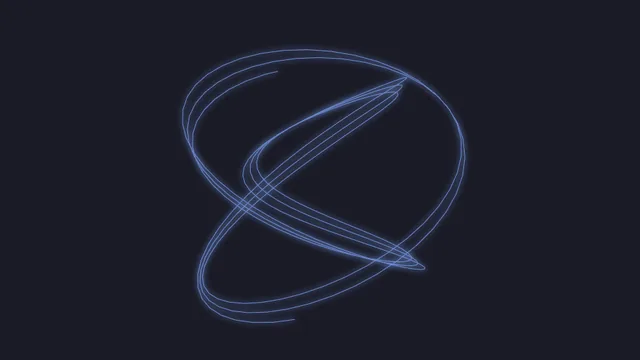<br>**Harmonograph**<br><sub>Two pendulums draw a glowing figure that winds inwards, a new one each time round.</sub> | 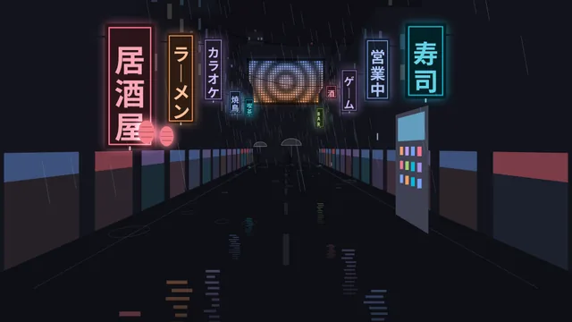<br>**Tokyo Drip**<br><sub>A rainy side street at night: neon signs, lanterns and an LED screen.</sub> | 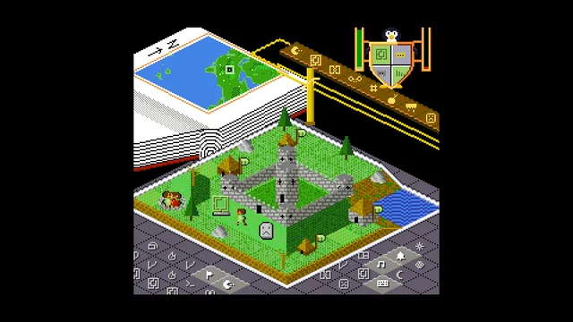<br>**Distro Wars**<br><sub>A parody of a popular God-game. The Omarch King's settlements fly Omarchy green, until segfault and Dependency Hell strike.</sub> |
| 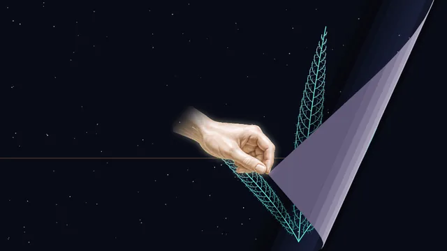<br>**Omnipotence**<br><sub>Figures drawn over the lines of code that draw them, until the Hand of Omnipotence turns the page.</sub> | 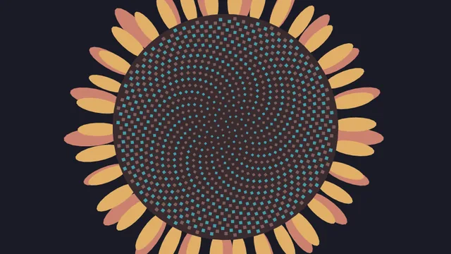<br>**Fibonacci**<br><sub>The sequence in pictures: squares and spirals, a sunflower, rabbits, Pascal's triangle.</sub> | 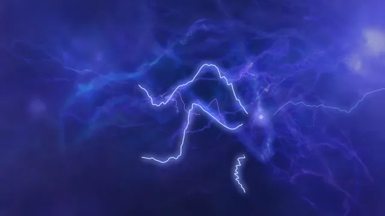<br>**Trying To Remember**<br><sub>Thoughts wander through a fog of half-remembered ones, each reaching for an idea just out of reach.</sub> |
| 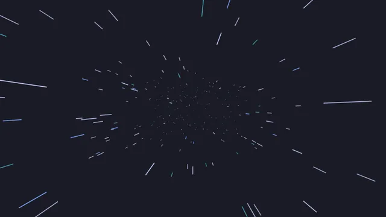<br>**Starfield**<br><sub>Flying through stars that streak past as they come close.</sub> | 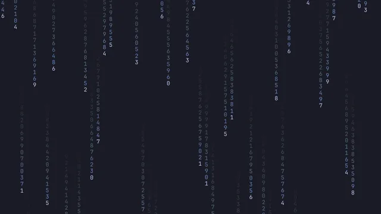<br>**Cascade**<br><sub>Columns of ever-changing digits falling down the screen.</sub> | 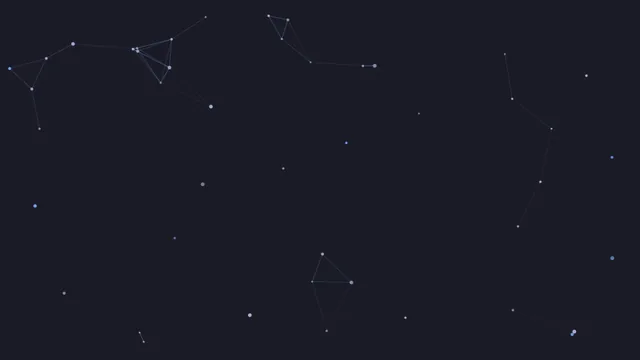<br>**Constellations**<br><sub>Drifting stars, joined by faint lines whenever two pass close.</sub> |
| 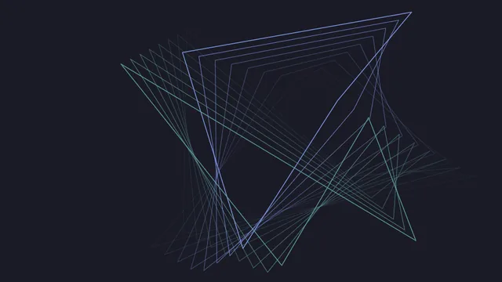<br>**Echoes**<br><sub>Two shapes bouncing around the screen, trailing echoes of where they've been.</sub> | 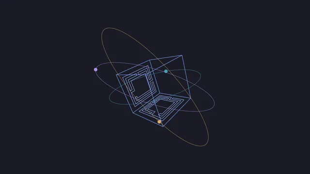<br>**Orbits**<br><sub>The Omarchy box turning in its orbits, then a slowly changing Lissajous figure.</sub> | 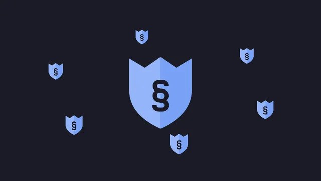<br>**Badge**<br><sub>ScreenSafe's shield, the Omarchy mark or your own badge: bouncing, shattering, waving and in orbit, smoothly or as pixel art.</sub> |
| 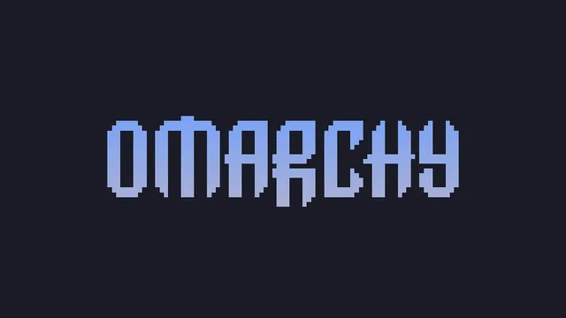<br>**Omarchy**<br><sub>Your screensaver art from <i>Style › Screensaver</i>, revealed a different way each time.</sub> | <br>**Theme backgrounds**<br><sub>Your theme's own backgrounds, one after another, drifting slowly across the screen.</sub> | <br>**Photos**<br><sub>Your photos from <code>~/Pictures/Screensaver</code>, or sets of examples (nature, technology, aerospace, and astronomy from NASA): full screen, whole, or as prints or Polaroids, in their own tones or the theme's.</sub> |

<sub>Frames from the renderer at each pack's own preview moment (Photos as prints, with its examples), in Tokyo Night, Omarchy's default theme, with its first background and Omarchy's own screensaver art. To show your own badge in Badge, put an image at <code>~/.config/omarchy/screensafe/badge.png</code> (or <code>.webp</code>, <code>.jpg</code> or <code>.jpeg</code>).</sub>

## Install

```sh
omarchy plugin add https://github.com/jeremydixon22/omarchy-screensafe
omarchy plugin enable io.github.jeremydixon22.screensafe
```

ScreenSafe's shield appears in the bar, in your theme's accent. Nothing changes until you switch it on: Omarchy's own screensaver stays in use until then.

ScreenSafe needs Omarchy 4 on an x86-64 or 64-bit ARM computer, and nothing else. It's tested on Omarchy 4.0.4 with Hyprland 0.56 and Quickshell 0.3.1 on x86-64; the ARM build is tested under emulation, drawing identical frames.

## Use

Click the shield in the bar.

| | |
|---|---|
| **Settings → Overlay** | Optional clock, date, battery, CPU and memory over any pack. The position grid stays pinned while other options scroll. Choose one of nine positions, size, opacity and colors; slow drift is on by default. System readings are off until selected. Use Preview to try the result. |
| **Settings → Performance** | Prepare a short loop of a supported screensaver on external power, then reuse it to reduce runtime work. Off by default; use on battery only or all the time, choose a storage limit, cancel preparation, or clear loops. Prepared loops repeat a segment. Clocks, Photos, Videos, the overlay, and unsupported displays use normal playback. |
| **Enable** | Show ScreenSafe instead of Omarchy's screensaver when you're idle. Right-clicking the shield does the same. |
| **After … idle** | How long you're idle before it shows. It follows Omarchy's screensaver time until you choose your own with **−** and **+** (or the arrow keys), from 1 minute to an hour; step back below 1 minute to follow Omarchy's again. Point at it to see whose time it is and when Omarchy locks. |
| **Pack** | Which screensaver to show. **Automatic** shows the current theme's pack if it has one, and the Omarchy pack otherwise. Every entry shows its thumbnail and description in a stable card. Press `f` or click ☆ to make it a favorite, listed first. |
| **Color** | Theme-based packs offer theme swatches and a custom HSV picker, pinned below the scrolling options. Original theme colors remain the default. Tinting preserves light/dark detail; Photos and Videos show this control when **Tone → Theme** is selected. |
| **⚙ Settings** | For a pack that has them: click ⚙, or press → or `s` on its row. The page shows the pack running live as you change them; turn **Live preview** off for a still thumbnail and the usual Preview. |
| **Preview** | Show the chosen pack now. Any key, click, touch or mouse movement closes it. |
| **About** | Links to this page, to the [catalog of packs others have made](https://github.com/jeremydixon22/omarchy-screensafe-packs), and to guides for making and sharing your own. |

If anything stops ScreenSafe showing, such as Omarchy locking first, a note at the bottom of the panel says so.

<details>
<summary><b>From a terminal or a key binding</b></summary>

```sh
omarchy-shell screensafe preview
omarchy-shell screensafe enable        # or: disable
omarchy-shell screensafe pack auto     # or the path of a pack the panel lists
omarchy-shell screensafe delay 300     # seconds idle before it shows; omarchy to follow Omarchy's
omarchy-shell screensafe favorite PATH # star or unstar a pack the panel lists
omarchy-shell screensafe status
```

</details>

<details>
<summary><b>How it works with Omarchy's own screensaver</b></summary>

While **Enable** is on, ScreenSafe switches Omarchy's screensaver off and opens its own when Omarchy's would have opened. Turning it off, disabling the plugin or removing it switches Omarchy's back on. If you had already switched Omarchy's screensaver off yourself, ScreenSafe leaves it as you set it.

Omarchy stays in charge of everything else:

- **Timing:** unless you choose ScreenSafe's own time, it opens one second after Omarchy's screensaver would have (`idle.screensaver` in `~/.config/omarchy/shell.json`).
- **Locking:** Omarchy still locks on its own schedule (`idle.lock`), and locking closes the screensaver. If ScreenSafe's time is longer than that, Omarchy locks first, and the panel says so.
- **Stay awake** pauses ScreenSafe just as it pauses Omarchy's screensaver.
- **Video and games:** whatever keeps Omarchy's screensaver away keeps ScreenSafe away too. It watches for idle the same way, honoring apps that ask Wayland to keep the screen awake.

If you switch Omarchy's screensaver back on yourself (for example with `omarchy toggle screensaver`), ScreenSafe steps aside and turns itself off the next time it would have opened.

The **Screensaver** entry in Omarchy's menu always opens Omarchy's own screensaver. To open ScreenSafe's, use **Preview** or `omarchy-shell screensafe preview`.

If the shell stops while ScreenSafe holds Omarchy's screensaver off, Omarchy's stays off until ScreenSafe next loads, or until you remove `~/.local/state/omarchy/toggles/screensaver-off`.

</details>

## More packs

- **Find one:** see [the ScreenSafe pack catalog](https://github.com/jeremydixon22/omarchy-screensafe-packs) for community listings and the current submission status.
- **From a theme:** a theme can ship a pack in a `screensafe` folder next to its `colors.toml`. Omarchy keeps that folder when it installs the theme, since it's only data, and **Automatic** shows it while that theme is in use.
- **Your own:** put a pack folder in `~/.config/omarchy/screensafe/packs/`, and it appears in the panel the next time you open it.

## Make your own

Start with [Making a screensaver](docs/MAKING.md); the format is in [Making packs](docs/PACKS.md) and [Expressions](docs/EXPRESSIONS.md). The built-in packs in [`packs/`](packs) are worked examples.

**With a coding agent:** [`skills/screensafe-packs`](skills/screensafe-packs/SKILL.md) is an agent skill that walks your agent through making, checking and sharing a pack. Link it into your agent's skills folder, such as `~/.claude/skills/`, and describe the screensaver you want.

The renderer checks a pack line by line, measures its cost and its flashing, and renders any frame:

```sh
screensafe=~/.config/omarchy/plugins/io.github.jeremydixon22.screensafe/bin/screensafe-$(uname -m)
$screensafe check path/to/pack
$screensafe render path/to/pack --time 12 --out /tmp/frame.png
```

To share it, see [Community packs](docs/COMMUNITY.md).

## Safety

- **Packs are data.** The format has no way to run a program, open a file outside its own folder, reach the network or loop without end. Everything a pack asks for is checked and compiled before it's shown, and every per-frame cost is bounded.
- **The renderer confines itself.** Before reading a pack it can only read the packs, theme, art and photos folder it was given; after loading it, it gives up new file access. Photo files opened while loading remain readable. It can never reach the network or start programs. This uses Linux's Landlock, and the renderer refuses to read a pack if the kernel can't confine it.
- **Flashing is limited.** Normal playback measures every combined frame. Prepared playback checks the final GPU output, repeat seam and black entry/exit before issuing a local approval bound to the video's SHA-256 and exact playback profile. A missing, changed or incompatible approval uses normal playback. See [the limits and trust assumptions](SECURITY.md#prepared-playback-050).
- **Stalled frames are stopped.** If drawing a frame stalls for about five seconds, the renderer exits and ScreenSafe falls back to the built-in pack.
- **The binaries are checkable.** Both renderers and all six native helpers have pinned rebuild recipes. CI checks the bytes, runs native checks on both architectures, and attests the executables on main/release branch pushes; see [how to rebuild and compare them](docs/BINARY-PROVENANCE.md).

[SECURITY.md](SECURITY.md) has the details and how to report a problem; [Notes for reviewers](docs/REVIEW-NOTES.md) lists everything ScreenSafe runs and writes.

## Remove

```sh
omarchy plugin remove io.github.jeremydixon22.screensafe
```

Removing the plugin switches Omarchy's screensaver back on if ScreenSafe had switched it off. ScreenSafe keeps a small record in `~/.local/state/screensafe/` while it holds Omarchy's screensaver off; you can delete that folder afterwards. Your own packs in `~/.config/omarchy/screensafe/` are left in place. Prepared loops are private, reproducible files in `~/.cache/omarchy/screensafe/prepared/`; clear them in Performance or remove that cache directory after uninstalling.

## What's inside

- `Service.qml`, `Panel.qml` and `ShieldMark.qml`: the plugin. Procedural playback starts ScreenSafe's renderer and Omarchy's `omarchy-shell`. Compressed Videos uses a separate trusted broker, and optional prepared playback uses its own controller and confined codec/GPU worker.
- `bin/screensafe-x86_64` and `bin/screensafe-aarch64`: the renderer, static Linux executables built reproducibly from [`renderer/`](renderer). The plugin runs the one for your machine.
- `bin/screensafe-cache-*`, `screensafe-sandbox-*` and `screensafe-media-*`: the included GPU worker, sandbox launcher and media resource-limit launcher for each architecture. Their sources and pinned rebuild inputs are included.
- `screensafe_gpu.py`: shared retained-device and bounded PCI metadata checks for both decoder paths.
- `packs/`: the built-in packs, and `tools/`: the generators for the larger ones.
- `skills/screensafe-packs/`: instructions for coding agents that make packs. The plugin doesn't install or read them.

The renderer embeds [JetBrains Mono](https://github.com/JetBrains/JetBrainsMono) (SIL Open Font License 1.1) and uses the Rust libraries listed in [THIRD_PARTY_NOTICES.md](THIRD_PARTY_NOTICES.md). Procedural and JPEG playback use the static renderer. Catalog/thumbnails and compressed Videos also use the bundled Python broker; compressed decoding uses system FFmpeg. Import and optional prepared playback use FFmpeg/ffprobe, MPV and graphics/runtime libraries already supplied by standard Omarchy. Bubblewrap and ScreenSafe's own helpers are bundled. There is no installer, package installation, compiler requirement or download at run time. The controller uses a read-only package-version query for cache identity. The GPU worker connects to one render node; it has no compositor socket, home directory or network access.

The expression language borrows ideas and a few function names from MilkDrop's preset equations, but no code; [Expressions](docs/EXPRESSIONS.md#compared-with-milkdrop) describes how they differ.

## License

ScreenSafe's own source is MIT; see [LICENSE](LICENSE). The bundled GPU worker is distributed under GPL-2.0-or-later, Bubblewrap under LGPL-2.1-or-later, and the static media launcher includes MIT-licensed musl. See [native component notices](docs/NATIVE-PACKAGE.md) and [THIRD_PARTY_NOTICES.md](THIRD_PARTY_NOTICES.md).

Videos: [format and import instructions](docs/VIDEO-PROTOTYPE.md).

<details>
<summary>Prepared playback requirements and rebuilding</summary>

Prepared playback is optional; its executable is already included. Maintainers can reproduce all six native helpers with the pinned cross-build (Python 3.12+, `dpkg-deb`, and network access for checksum-verified build inputs; no system package installation by the script):

```sh
python3 scripts/build-native.py /tmp/screensafe-native
scripts/verify-native
```

Prepared playback supports a single, unrotated display up to 4096 × 2160 and 64 Hz when a PCI GPU fits the bounded metadata profile and its driver exports linear XRGB buffers. Preparation checks both software and hardware-copy decoding and uses a passing profile; direct hardware interop is excluded. Updates to relevant binaries, graphics/codec libraries, kernel, theme, settings or display invalidate reuse. The small settings preview stays live. With **Prepared playback** enabled, full-screen Preview and idle activation automatically prepare a missing eligible loop on known external power. A progress bar appears over live rendering when there is enough headroom, or replaces it while preparation is busy. Completion resumes live rendering; later activations may reuse the approved loop. **Use on battery only** controls reuse and still permits preparation on external power. Choose **Rebuild selected screensaver** to regenerate it explicitly. Unsupported setups use normal playback.

Prepared playback can reduce power for demanding effects. Simple screensavers may cost less to draw live than to decode and present as video; prepared playback remains off by default. The prepared segment repeats, while live playback can continue generating new variations. On battery, an empty cache falls back without hashing the runtime libraries. Automatic generation runs only on external power, and input, lock or shell exit cancels unfinished work. Existing approvals still receive full identity and sealed-media verification; independent file hashes run in bounded parallel workers. Updated decoder/policy identities require fresh preparation.

The worker links stable system-library ABIs and leaves media libraries and hardware drivers with Omarchy, so distribution security updates continue to apply. Full helper source, upstream Bubblewrap source, license texts, build-input checksums and the binary manifest are included; [native packaging](docs/NATIVE-PACKAGE.md) explains the dependency and license boundaries. Reproduction and a matching GitHub attestation are separate checks.

</details>
